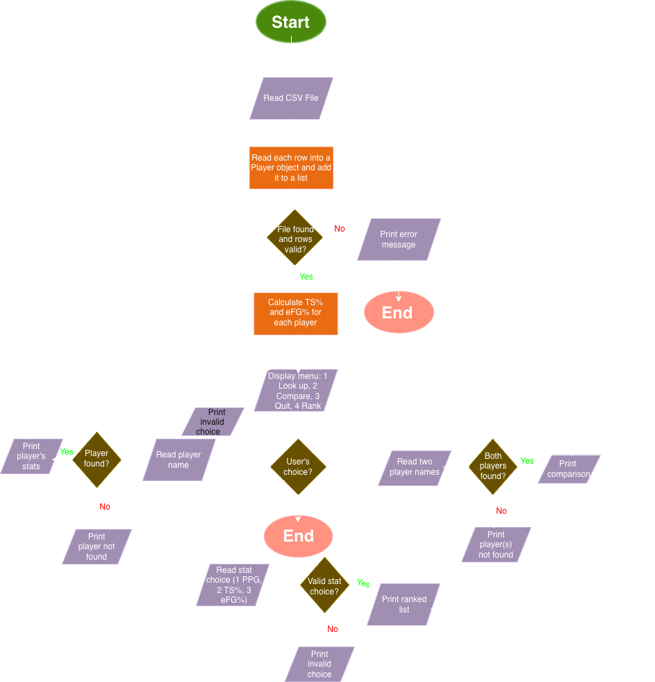

# WNBAnalytics
A Java command-line tool that calculates statistics for the Golden State Valkyries and Atlanta Dream players from the 2026 WNBA Finals.
## The Problem
Most fan-friendly stats tools focus on men's basketball, so women's basketball fans have few easy ways to dig into advanced metrics like true shooting percentage. WNBAnalytics is a Java command-line tool that reads box score data from a CSV file, calculates advanced stats for each player, and lets users compare players side by side.

## How It Works
The program loads `data/box_scores.csv`, builds a Player for each row, and calculates true shooting % and effective FG %. A menu lets you look up a player, compare two players, or rank players by a stat.



## MVP Scope
- Read player box score data from a CSV file
- Player and BoxScoreLine classes to organize the data
- Calculate two stats to focus on; true shooting % (TS%) and effective field goal % (eFG%), with divide-by-zero edge case
- Command-line menu to look up a single player's advanced stats or compare two players side by side

## Tech Stack
- Language: Java 
- Libraries: Java standard library
- Data storage: CSV file that I write
- Interface: Command-line menu
- Tools: Git/GitHub

## Setup
Requires JDK 17 or newer. Run every command from the repo root.

```
git clone https://github.com/manyaj-08/WNBAnalytics.git
cd WNBAnalytics
javac -d out src/*.java
java -cp out Main
```

## Example Run
(paste real input and output from your terminal in a code block, plus a few valid names to try: Angel Reese, Gabby Williams, Allisha Gray)

## Data Note
Stats are 2026 WNBA Finals per-game averages for ATL and GSV players, rounded to one decimal place. Percentages for players with very few shot attempts are approximate.

## Roadmap
- [x] Set up repo and project structure
- [x] Create CSV and BoxScoreLine/Player classes
- [x] Load CSV with error handling
- [x] True shooting % and effective FG %
- [x] Menu, lookup, and comparison
- [x] Rank players by a stat (Schedule feature)
- [ ] Usage rate
- [ ] Player Efficiency Rating (PER)
- [ ] Filter by team
- [ ] Export results to CSV

## Future Plans
- Usage rate for the player's team
- Player Efficiency Rating?
- Filter by team or by a minutes threshold, some other stat
- Write player or comparison results to a CSV file instead
